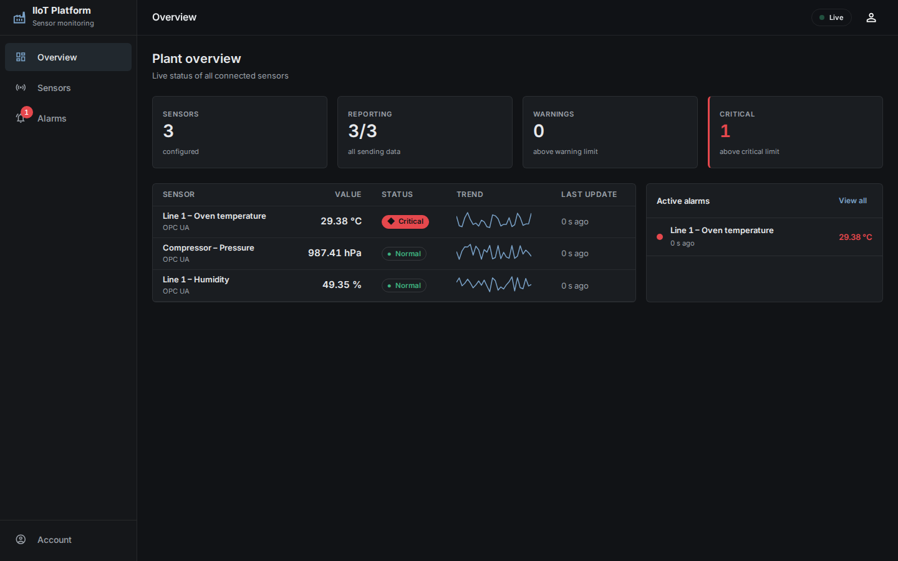
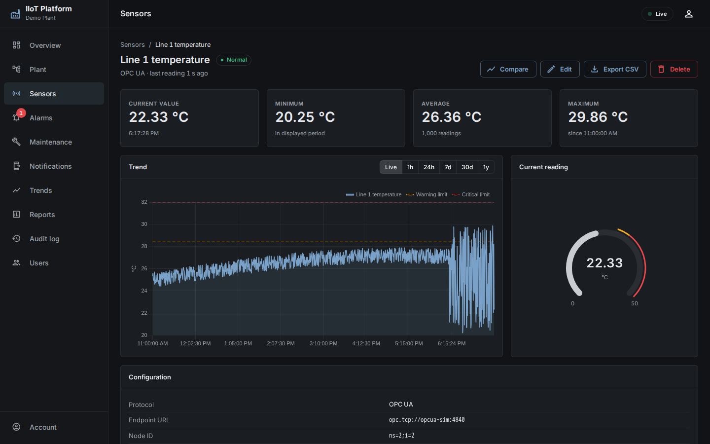
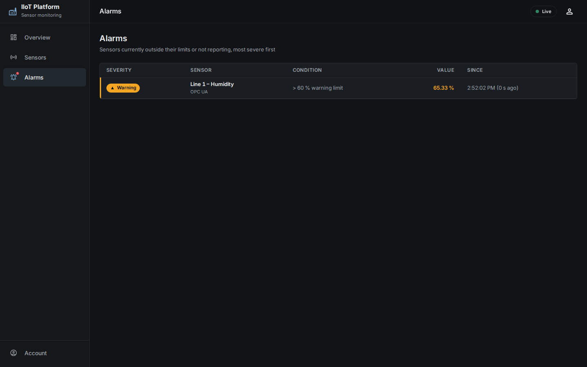
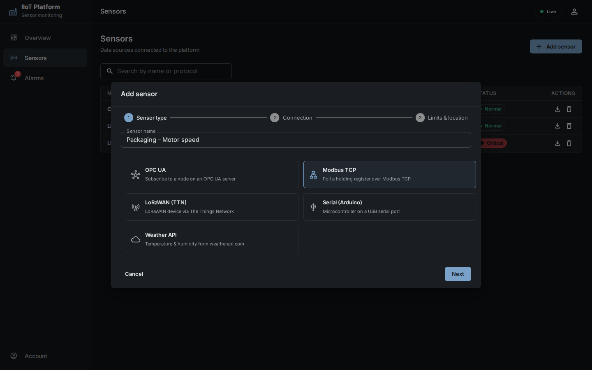
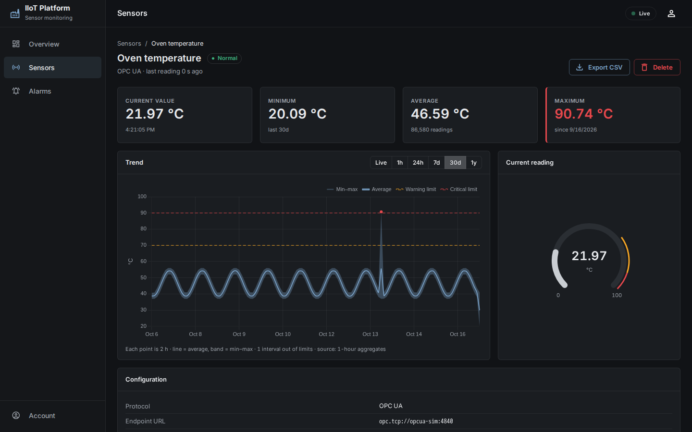

Industrial IoT Sensor Monitoring & Data Platform

[Docker-enabled] [Frontend-React 18 + TypeScript] [Backend-C# ASP.NET Core]

A comprehensive Industrial IoT (IIoT) platform designed for real-time monitoring, processing, and visualization of data streams. The application supports multiple industrial communication protocols and provides a modern, responsive dashboard for managing sensors and analyzing telemetry.

Short Introduction
------------------
This project is a real-time industrial data monitoring web application developed as a diploma thesis at the International University of Greece. It allows users to collect, store, and visualize data from multiple sensor sources such as Arduino devices, PLCs (via Modbus/OPC UA), LoRaWAN (via The Things Network), and external APIs (e.g., OpenWeatherMap). The platform provides live dashboards, interactive maps, historical charts, gauge meters, CSV export, and secure user authentication. It is built with a modern, scalable architecture (React frontend, C# / ASP.NET Core backend, PostgreSQL + TimescaleDB database) and supports IoT protocols like MQTT, Modbus, OPC UA, and Serial communication.

Supported Industrial Protocols
------------------------------
The platform integrates specialized Protocol Handlers in the backend, enabling seamless connectivity with:
1. OPC UA (IEC 62541): Client-server industrial communication with node-based addressing, ideal for PLCs and SCADA systems (node-opcua).
2. Modbus TCP: Register-based communication over Ethernet for reading holding registers of industrial units (modbus-serial).
3. MQTT (The Things Network - TTN): Publish-subscribe architecture for long-range, low-power wireless sensors (LoRaWAN).
4. Serial Communication (UART): Direct data reading from microcontrollers (e.g., Arduino, ESP32) via USB serial connection (serialport).
5. REST APIs: Integration of external services (such as the OpenWeatherMap API) to correlate environmental conditions with industrial processes.

Features
--------
- User registration & login (secure password hashing)
- Add/register multiple sensors (Arduino, PLC, LoRaWAN, Weather API)
- Real-time data visualization – Line charts, gauge meters, live updates
- Interactive map – Sensor positions with dynamic markers & popups
- Threshold alerts – Visual warnings when values exceed limits
- CSV export – Download sensor history for offline analysis
- Multi-protocol support – MQTT, Modbus, OPC UA, Serial, REST
- Modular architecture – Easy to add new sensor types
- Dockerized – One-command deployment

Installation & Execution (Docker)
----------------------------------
The application is fully containerized using Docker and Docker Compose, allowing the entire stack (Frontend, Backend, Database) to run seamlessly without local dependencies.

### Prerequisites
- Docker Desktop installed on your system.
- Ports 8080, 5000, and 5432 must be free.

### Steps to Run

1. Clone the Repository:
   git clone https://github.com/Panmpourr/industrial-iot-sensor-platform.git
   cd industrial-iot-sensor-platform

2. Environment Configuration:
   In the root directory, create a .env file based on the provided .env.example:
   cp .env.example .env
   
   Fill in your database credentials (DB_USER, DB_PASSWORD, DB_NAME) in the .env file. For local frontend development, also create a .env in the Sensor-app/frontend folder with VITE_API_URL=http://localhost:5000 (Docker passes this value automatically).

3. Start the Containers:
   In the root directory (where docker-compose.yml is located), execute:
   docker compose up --build

4. Access the Platform:
   - Frontend Dashboard: http://localhost:8080
   - Backend API: http://localhost:5000
   - PostgreSQL / TimescaleDB: Port 5432 (User: appuser, Database: appdb)

Note: If you prefer to run without Docker, start PostgreSQL with the TimescaleDB extension (run sql/init.sql, then sql/history.sql, once), copy .env.example to .env (set a long random JWT_SECRET), then:
   - Backend: install the .NET 10 SDK and run `dotnet run --project Sensor-app/backend-dotnet/src/IIoT.Api`
   - Frontend (Node.js 22): `npm install` and `npm run dev` in Sensor-app/frontend/ (http://localhost:3000)
   - Frontend checks: `npm test` (Vitest) and `npm run build` (TypeScript typecheck + Vite production build)
   - Tests: `dotnet test Sensor-app/backend-dotnet`

Testing with the OPC-UA Simulator
---------------------------------
For experimental testing of the OPC-UA industrial protocol, a ready-to-use Python simulator is included.
The easiest way is to start it together with the platform as an optional Docker Compose profile:

   docker compose --profile simulator up -d

Then add a "PLC OPC-UA" sensor in the dashboard with endpoint URL opc.tcp://opcua-sim:4840 and one of the nodes:
   - Temperature: ns=2;i=2
   - Humidity: ns=2;i=3
   - Pressure: ns=2;i=4

The simulator generates randomized (but within-limits) values every second, which the backend reads via an OPC UA subscription and pushes live to the dashboard. (Without Docker: pip install opcua, then python Sensor-app/scripts/opcua_simulator.py.)

Demo Video
----------

https://github.com/user-attachments/assets/4ba03449-b058-4534-b57a-e3b04eee6ee1

Screenshots
-----------
The dashboard follows ISA-101 "high-performance HMI" principles: neutral greys for normal operation and colour reserved for abnormal states, so alarms stand out at a glance.

| Plant overview | Sensor detail |
|---|---|
|  |  |
| **Alarms** | **Add sensor** |
|  |  |

**30 days of history** – average line with a min–max band: a 40-minute overheating three days earlier is still visible as a spike and a critical marker, even though each point covers 2 hours.

System Architecture & Tech Stack
--------------------------------
The platform follows a loosely coupled Client-Server architecture, ensuring high scalability, security, and independent maintainability of its subsystems.

### 1. Frontend Layer (React + TypeScript, built with Vite)
- UI Design: Dark, high-performance HMI style (ISA-101) built with Material-UI 5: sidebar navigation, live connection indicator, plant overview with KPIs, sensor detail pages, an alarm list and a step-by-step "Add sensor" dialog. Fully responsive (desktop to phone).
- Status semantics: every sensor is Normal, Warning, Critical or "No recent data", shown with colour + shape + text so it stays readable for colour-blind operators.
- State Management: Utilizes React Hooks (useState, useEffect, useCallback) and the Context API for global user authentication sessions.
- Data Visualization: Real-time and historical graphs using Chart.js (react-chartjs-2) and Recharts. Integration of custom interactive Gauge Charts with dynamic color changes based on user-defined thresholds.
- Geospatial Data: Dynamic rendering of physical sensor locations on interactive maps using Leaflet (React-Leaflet).

### 2. Backend Layer (C# / ASP.NET Core, .NET 10)
- API Server: Asynchronous RESTful API endpoints for user authentication, sensor registration, and data operations.
- Data Processing: Real-time threshold monitoring mechanisms, analytics, and automated data exporting capabilities.

### 3. Data Layer (PostgreSQL + TimescaleDB)
- A single, fully local PostgreSQL 16 database with the TimescaleDB extension.
- Relational tables for users and sensor configurations (foreign keys, cascade deletes, JSONB for protocol-specific settings).
- A TimescaleDB hypertable (sensor_data) for time-series measurements, enabling fast time-range queries, compression and retention policies.
- Historian-style long-term storage (sql/history.sql):
  - Continuous aggregates `sensor_data_1m` (1-minute) and `sensor_data_1h` (1-hour, built hierarchically from the 1-minute layer) keep min / max / sum / count and the worst status per bucket. They are real-time, so the newest data appears before the background refresh.
  - Raw chunks are compressed after 7 days; raw data is kept 90 days, 1-minute buckets 1 year, hourly buckets forever.
  - `GET /sensor-history/{userId}/{sensorId}?from=&to=` picks the bucket size for the range (10 s for 1 hour … 1 day for 1 year, ~500 points at most) and reads the coarsest table that can serve it, so any range answers in milliseconds. The trend offers Live / 1h / 24h / 7d / 30d / 1y.

Technologies Used (Detailed)
----------------------------
Frontend:
- React 18 + TypeScript (strict mode) – typed API models shared across components
- Vite – dev server and production build (lazy-loaded dashboard chunk)
- Vitest + Testing Library – unit and component tests
- Material-UI (MUI) – UI components & theming
- React Router DOM – SPA navigation
- Axios – HTTP requests
- Chart.js + Recharts – Data visualization (line/bar charts, gauges)
- React-Leaflet + Leaflet – Interactive maps & sensor geolocation

Backend:
- C# / ASP.NET Core (.NET 10) – RESTful API server with controllers and dependency injection
- Background sensor manager (IHostedService) – one connector per sensor, automatically restored after a restart
- PostgreSQL + TimescaleDB (via pg) – Users, sensors and time-series sensor data
- ASP.NET Core Identity PasswordHasher (PBKDF2) – Password hashing
- JWT bearer authentication – every sensor endpoint is scoped to the logged-in user
- SignalR – live push of new sensor readings to subscribed dashboards (per-sensor groups, JWT-protected)
- Npgsql + Dapper – PostgreSQL / TimescaleDB access
- OPC Foundation .NET Standard stack, NModbus, MQTTnet, System.IO.Ports – industrial protocol clients
- xUnit – Unit tests
- dotenv – Environment variables

IoT & Communication Protocols:
- Serial (USB) – Arduino sensors (serialport)
- Modbus TCP/RTU – PLCs (modbus-serial)
- OPC UA – Industrial systems (node-opcua)
- MQTT – The Things Network (LoRaWAN) integration (mqtt)
- REST APIs – External weather data (OpenWeatherMap, etc.)

DevOps & Deployment:
- Docker – Multi-container setup (frontend, backend, PostgreSQL/TimescaleDB)
- Docker Compose – Orchestration
  
Project Structure
-----------------
industrial-iot-sensor-platform/

├── docker-compose.yml         # Orchestration of the 3 main Containers

├── sql/

│   ├── init.sql               # PostgreSQL/TimescaleDB schema
│   └── history.sql            # Continuous aggregates, compression and retention

├── scripts/

│   └── opcua_simulator.py     # OPC-UA PLC Simulator in Python

└── Sensor-app/

    ├── backend-dotnet/        # C# / ASP.NET Core API Server, protocol connectors & tests
    
    └── frontend/              # React + TypeScript SPA (Vite), served by nginx
    
The Process (Development Workflow)
-----------------------------------
1. Requirements analysis – Defined functional/non-functional needs (real-time, multi-protocol, user auth, maps, CSV).
2. Architecture design – Client-server model with REST APIs, separation of concerns.
3. Frontend implementation – React SPA with components for login, dashboard, sensor registration, charts, and maps.
4. Backend implementation – C# / ASP.NET Core endpoints for auth, sensor management, data retrieval, and export (originally Node.js/Express, later ported to .NET).
5. Database setup – PostgreSQL + TimescaleDB for users, sensors and time-series readings.
6. Sensor handlers – Developed modular handlers for Serial, Modbus, OPC UA, MQTT (TTN), and external APIs.
7. Real-time integration – History is loaded via the REST API; new readings are pushed to the dashboard with SignalR (WebSockets) as soon as they are stored.
8. Dockerization – Created Dockerfiles and docker-compose.yml to run all services consistently.
9. Testing – Validated with actual Arduino, TTN, and simulated PLC/OPC UA data.
10. Documentation – Wrote thesis (PDF) and this README.

What I Learned
--------------
- Building a full-stack IoT platform from scratch using React, C# / .NET, and a relational/time-series database.
- Integrating industrial protocols (Modbus, OPC UA, MQTT) into a web application.
- Handling real-time data flows and visualizing them with Chart.js and Recharts.
- Implementing secure authentication (PBKDF2 password hashing, JWT, CORS).
- Using Docker to containerize and orchestrate frontend, backend, and database services.
- The power of AI assistance (ChatGPT) during development – debugging, code refactoring, and documentation writing.
- Managing geolocation with Leaflet.

How It Can Be Improved (Future Work)
-------------------------------------
- AI/ML integration – Predictive maintenance, anomaly detection on sensor streams.
- More industrial protocols – Profinet, BACnet, CAN bus.
- Role-based access control (RBAC) – Admin, operator, viewer roles.
- Enhanced dashboard – Customizable widgets, drag-and-drop layout.
- Edge computing – Run parts of the backend on Raspberry Pi or industrial gateways.

Security & Data Protection
--------------------------
- Password Hashing: PBKDF2 with a random salt per password (ASP.NET Core Identity PasswordHasher); legacy plain-text passwords are upgraded automatically on first login.
- Authentication: JWT bearer tokens (12 h lifetime); users can only access their own sensors and data.
- CORS Policies: Strict access restriction to backend API endpoints, allowing only whitelisted origins.
- Data Isolation: Sensors and their measurements are linked to their owner via foreign keys; data queries are scoped by user.
  
Author & Supervision
--------------------
Author: Panagiotis Bourmpoulas (AM: 2020/134)
Supervisor: Assistant Professor Dimitrios Bechtsis
Institution: International University of Greece – Department of Production and Management Engineering
Thesis title: Development of a REACT application for data flows in industry
Year: 2025

License
-------
All rights reserved. For non-commercial, educational or research use only, provided that the source is acknowledged. See the copyright notice in the full thesis (page 2).
